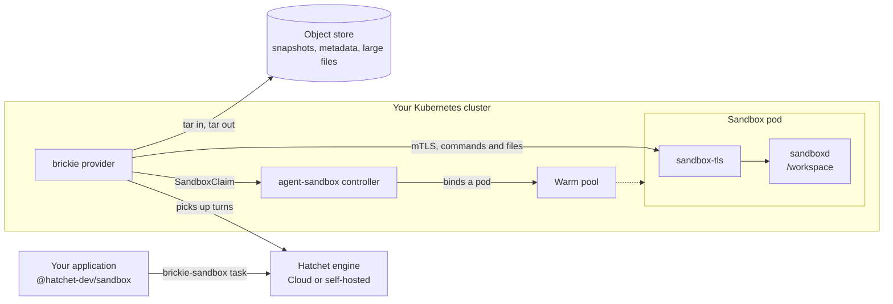

# Architecture

This page documents how all the different components of `brickie` fit together. It may be helpful to familiarize yourself with the concept of a [Hatchet task](https://docs.hatchet.run/v1/tasks) before reading this doc. Every SDK call (`exec`, `create`, `kill`, etc.) is a Hatchet task.

## High-level architecture

Hatchet runs outside your cluster. The sandbox provider runs inside of the cluster and connects to Hatchet directly, so it doesn't need ingress or inbound rules.

When your task calls `exec('make test')`, here's what happens under the hood:

1. The SDK starts a `brickie-sandbox` run in your tenant. Hatchet queues it like any other task, so it shows up in the dashboard and gets retried if something goes wrong.
2. The provider picks the run up. It finds the sandbox, or starts one from the latest snapshot if the old one is gone.
3. The command runs inside the sandbox through `sandboxd`. Once the command completes, `stdout`, `stderr` and the exit code come back.
4. The provider tars the workspace and streams it to the store as a new snapshot. After this, it move the sandbox's `latest` pointer to it.
5. The result goes back through Hatchet to your task, with the new snapshot ID attached.

If the provider dies halfway, Hatchet retries the run with the same ID. This means that if the provider finds an existing result, it simply hands it back instead of running the command twice.

## Components

| Component                    | Runs where                   | Does                                                                                                               |
| ---------------------------- | ---------------------------- | ------------------------------------------------------------------------------------------------------------------ |
| SDK (`@hatchet-dev/sandbox`) | your application             | Turns `sandbox.exec` and friends into `brickie-sandbox` task runs. Never talks to the provider or a sandbox.       |
| Hatchet                      | Hatchet Cloud or self-hosted | Queues, retries, records and shows every turn.                                                                     |
| Provider (`brickie worker`)  | your cluster or machine      | Picks up turns, drives sandboxes, writes snapshots. One per tenant.                                                |
| Driver                       | inside the provider          | Starts and finds sandboxes on Docker or Kubernetes.                                                                |
| sandboxd                     | PID 1 in every sandbox       | The [agent-sandbox](https://github.com/kubernetes-sigs/agent-sandbox) daemon. Commands over gRPC, files over REST. |
| Store                        | a bucket                     | Snapshots, sandbox metadata, turn results and staged large files.                                                  |

## Turns

Every call the SDK makes is one turn which runs as a Hatchet task. The provider serves every turn, but not every turn reaches a sandbox. `$list` and `$fs.presign` are answered from the object store. `$delete` stops the sandbox and then removes everything the store holds for it. `$create`, `$connect`, `$destroy`, `$command` and the other `$fs.*` functions go to the driver, which finds the sandbox or starts one and talks to `sandboxd` inside it.

Each sandbox runs one turn at a time while the rest are queued by the provider. A `$command` turn always returns `stdout`, `stderr` and `exitCode`. A non-zero exit code does not fail the task, it is a normal answer, and your task decides what to do with it.

Every turn comes back with timings for `claim`, `restore`, `exec` and `checkpoint`, so you can see where the time went.

## Snapshots

The sandbox's files live in `/workspace`. After every file-modifying turn, the provider runs `tar` inside the sandbox and streams the archive to the store. That archive is a snapshot with the ID `<sandboxId>/<runId>`, stored under `snapshots/`. Snapshots are immutable. Each sandbox has a `latest` pointer corresponding to its newest snapshot.

The run ID in the snapshot ID is the one Hatchet gave the task run, and Hatchet reuses it when it retries. A retried turn finds the result it already stored and returns it without running the command a second time. That is why a sandbox call is safe inside a durable task.

The SDK calls operate on snapshots in the following cases:

- `connect(id)` brings a sandbox back. If it is still running, nothing happens. If it is gone, a new one starts from the latest snapshot.
- `create({ from })` starts a new sandbox from any snapshot in the form of a fork. The original keeps going on its own.
- `kill()` stops the sandbox and keeps its snapshots.
- `delete` removes the sandbox and all its snapshots.

## Files

A file up to `--max-file-bytes`, 2 MiB by default, travels inside the task itself. A larger file never goes through Hatchet. For a write, the SDK asks the provider for a presigned URL to one object in the store, uploads the bytes to that URL, and then the provider streams the staged object into the sandbox. A read works in reverse: the provider copies the file from the sandbox to the store and the SDK downloads it from a presigned URL. A URL is valid for 15 minutes and for one sandbox only.

The provider never opens a sandbox's files itself. Reads, writes and listings go through `sandboxd`'s file API. `mkdir`, `rename`, `copy` and `remove` run as commands inside the sandbox, after a check that the path stays inside `/workspace`. Because of this, the Docker and Kubernetes drivers share the same code for everything that happens inside a sandbox.

## Idle and lifetime

A sandbox that gets no turn for the idle TTL is removed. The provider sets the default and the SDK can ask for a different one at create, up to `--max-sandbox-idle-ttl`. On Kubernetes the deadline is written on the claim itself, so the agent-sandbox controller removes the pod on time even if the provider is down.

The idle TTL is the only time limit the provider sets. How long a single call may run is up to the SDK's `timeoutMs` and your task's own timeout.
