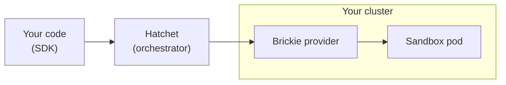

# Security

Sandboxes run untrusted code. While this document lays out the security boundaries when using `brickie`, we highly recommend running sandboxes in a completely isolated cloud account, or at minimum, a separate VPC with tightly controlled IAM permissions.

To report a vulnerability, use the [security policy](../SECURITY.md), not a public issue.

## Threat Model

It is assumed that the code running inside the sandbox is hostile and tries to break out into and out of your cloud account. It may be an agent that was prompt-injected, a script from another source that you don't control, or even a user who is deliberately trying to be hostile. The attack paths may include trying to access snapshots from other sandbox sessions or to send data outside of the intended network boundaries.

Another type of attacker is anyone holding a Hatchet token for your tenant. With the token they are able to start sandboxes and run commands in them but they should not be able to make the provider do anything a sandbox could not do on its own.

## How a call reaches a sandbox



Your code never talks to the sandbox directly. You use the Hatchet sandbox SDK to start a sandbox, which is simply a Hatchet task underneath. Hatchet then orchestrates these tasks and talks to the provider through its gRPC worker-based mechanism. The provider runs in your own Kubernetes cluster. Hatchet routes requests to the provider to start sandboxes and run commands in them, one by one. 

## Isolation

### Runtime boundary

Every sandbox runs as a separate Kubernetes pod, with a `runtimeClassName` that you choose at deployment time. The runtime can give pods their own Linux kernel (Kata Containers based microVMs) or a user-space kernel (gVisor). By default, the Helm chart installs the Kata runtime backed by the Cloud Hypervisor shim for maximum isolation.

### Inside the pod

A sandbox pod does not get any Kubernetes service account token meaning it cannot interface with the Kubernetes API server. By design, it does not have any access to the provider's environment variables and config values. The pod has privilege escalation off and the runtime's default seccomp profile is on.

More plainly, Linux capabilities are not dropped inside the sandbox container. The reasoning behind this is that package managers in commonly used images require them. The TLS sidecar in the same pod drops every capability. It runs as non-root and has a read-only filesystem.

The provider is designed to never `exec` into a pod. It talks to a process named `sandboxd` that runs as PID 1, over an authenticated channel.

### Resource limits

Every sandbox has a CPU, memory, and ephemeral storage limit. Note that the storage limit is the size of the workspace to make sure that a sandbox can only fill up its own disk and not starve its node or its neighbors.

### One call per sandbox

A sandbox runs one command call at a time. Subsequent calls are queued by the provider. Two sandboxes can never share a pod, their workspace or their snapshots. If a fork was made from a snapshot, the forked sandbox gets its own copy of the snapshotted data so that writes land in its own copy of the data from then on.

### TTL

Every sandbox has an idle time-to-live (TTL) attached to it. The pod inherits this TTL at creation time and the Kubernetes controller enforces it. Pods that cross this TTL are stopped and destroyed, even if the provider is down.

## Network

### Egress

By default, the Helm chart creates two `NetworkPolicy` resources to enforce network egress for every sandbox from reaching anything in the internet or your private address space. For this to be enforced, make sure your cluster has a CNI that supports it.

### File transfers

The SDK uses presigned URLs to transfer big files in and out of sandboxes. The sandbox itself does not need any network for it since the provider carries this out. The provider enforces `https` and refuses private as well as loopback, link-local and unspecified addresses. It also rejects any URLs with a redirect.

## Communication between provider and sandbox

### Mutual TLS

The sandbox agent (`sandboxd`) listens on loopback only. A sidecar in the same pod terminated TLS on the pod IP and accepts connections only when the client certificate is signed by the provider-owned certificate authority. The provider, in turn, accepts only a server certificate from the authority with the expected name. Both sides are checked to make sure a stray pod cannot pretend to be a sandbox and nothing else in the cluster can talk to one.

The provider creates the authority on first start. It issues fresh certificates and rotates them on its own. 

### Request tokens

Every request to a sandbox carries a bearer token. The sandbox only holds the SHA-256 of the token so it can check a request but cannot replay the token against another sandbox. The token itself is kept in a Kubernetes Secret in the provider's namespace.

## Data at rest

Snapshots, sandbox metadata, and staged files live in object storage in your own cloud account. Brickie does not encrypt objects itself, hence it is recommended that you turn on server side encryption on your storage bucket as well as implement a bucket policy to restrict data interchange only to the provider's identity.

Large files (more than 2 MiB by default) move between the SDK and the store through a presigned URL. The URL applies to only one object and has a TTL of 15 minutes.

## Tenancy

A single Brickie provider is meant to server one Hatchet tenant only. The store and sandbox namespace are not meant to be shared between tenants. 

## Supply chain

The provider, `sandboxd` and the agent-sandbox controller are all FIPS 140-3 builds. With the default Kata runtime the guest kernel boots with FIPS mode on as well.

Additionally, every container image is signed with cosign keyless signing and carrires a syft SPDX SBOM.

### Verifying images

`ghcr.io/hatchet-dev/brickie` is signed by the release workflow on a `v*` tag. `sandboxd` and `agent-sandbox-controller` are signed by a workflow run on `main`.

```sh
cosign verify ghcr.io/hatchet-dev/brickie:0.1.7 \
  --certificate-oidc-issuer https://token.actions.githubusercontent.com \
  --certificate-identity-regexp '^https://github.com/hatchet-dev/brickie/\.github/workflows/release\.yaml@refs/tags/v'

cosign verify ghcr.io/hatchet-dev/sandboxd:v1.0.8 \
  --certificate-oidc-issuer https://token.actions.githubusercontent.com \
  --certificate-identity-regexp '^https://github.com/hatchet-dev/brickie/\.github/workflows/[^@]+@refs/heads/main$'

digest=$(docker buildx imagetools inspect ghcr.io/hatchet-dev/brickie:0.1.7 --format '{{json .Manifest}}' \
  | jq -r '.manifests[] | select(.platform.architecture == "amd64") | .digest')
cosign verify-attestation --type spdxjson "ghcr.io/hatchet-dev/brickie@$digest" \
  --certificate-oidc-issuer https://token.actions.githubusercontent.com \
  --certificate-identity-regexp '^https://github.com/hatchet-dev/brickie/\.github/workflows/release\.yaml@refs/tags/v' \
  | jq -r .payload | base64 -d | jq .predicate > sbom.spdx.json
```

## Known gaps

- Linux capabilities are not dropped inside the sandbox container. The runtime boundary is what contains them and microVM based isolation is recommended for critical workloads.
- Brickie does not encrypt snapshots by itself.
- The Docker driver runs sandboxes as plain containers with no VM boundary, no network policy and no resource limits. It is, therefor, intended for local testing only.
- Init containers you configure run before untrusted code under full trust.
- Images are not validated in the sandbox pod. It is advised to enforce an admission policy for stronger security.

## Reporting a vulnerability

Use the [security policy](../SECURITY.md). It explains how to reach the maintainers privately.
